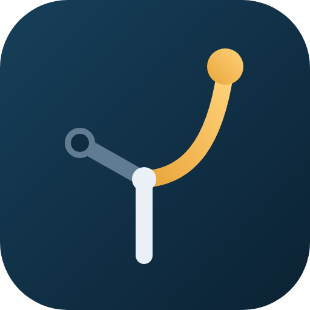

<p align="center"></p>

# Decision Coach

A Claude skill that helps people make better decisions using Naval Ravikant's principles and four mental models.

When someone asks for advice or feels stuck ("should I...", "I can't decide", "I'm torn between..."), the skill walks them through the decision step by step and ends with a clear recommendation.

## How it works

1. **Understand the decision**: for small decisions, gives a lean right away and asks one or two questions; for big ones, asks up to three focused questions first. It also puts a price on each option and looks for a hidden third option.
2. **Clear the lens**: spots sunk costs, identity traps, and fear. ("For important decisions, discard memory and identity, and focus on the problem.")
3. **Pick the right models**, always at least two:
   - **Compound Interest**: long-term paths, career, money, habits
   - **Inversion**: risk, fear of failing, being stuck
   - **Evolution and Game Theory**: decisions involving other people, or an unpredictable future
   - **Principal-Agent**: whose advice to trust, hiring, delegating
4. **Run each model** using its step-by-step procedure.
5. **Stress-test** against each model's known failure mode.
6. **Apply Naval's tie-breakers**: "If you can't decide, the answer is no" (with its exceptions), run uphill, play long-term games with long-term people, and never risk ruin.

The result is a recommendation with a confidence level, a few personal avoidance rules, one next step for this week, and what would change the recommendation.

## Files

```
naval-decision-coach/
  SKILL.md                          main instructions
  references/
    compound-interest.md
    inversion.md
    game-theory-evolution.md
    principal-agent.md
    naval-principles.md
naval-decision-coach.skill          packaged version for upload
assets/                             logo (SVG, 512 px PNG, 512 mm PDF)
```

## Installation

**Claude.ai**: download `naval-decision-coach.skill` and upload it under Settings, Capabilities, Skills.

**Claude Code**: copy the `naval-decision-coach` folder into `~/.claude/skills/`.

## Note

This skill is a thinking partner, not a substitute for professional advice. For medical, legal, tax, or major financial decisions, consult a qualified professional.
